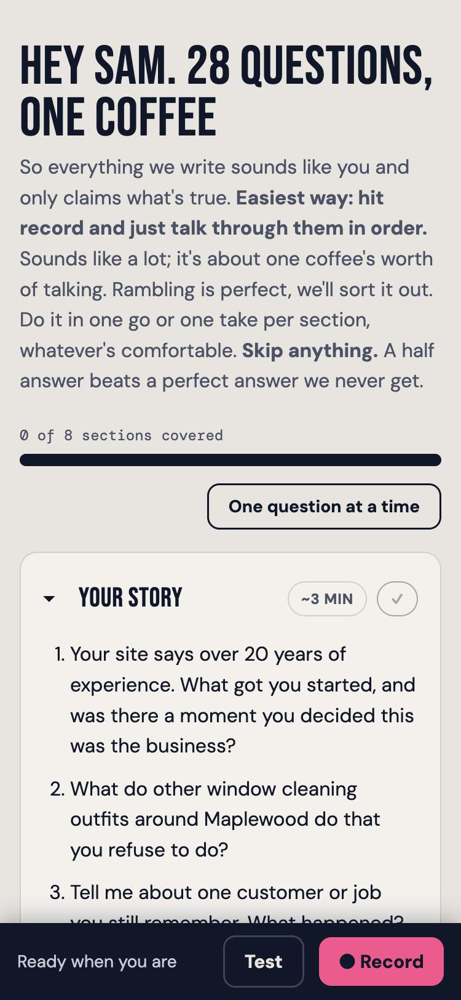
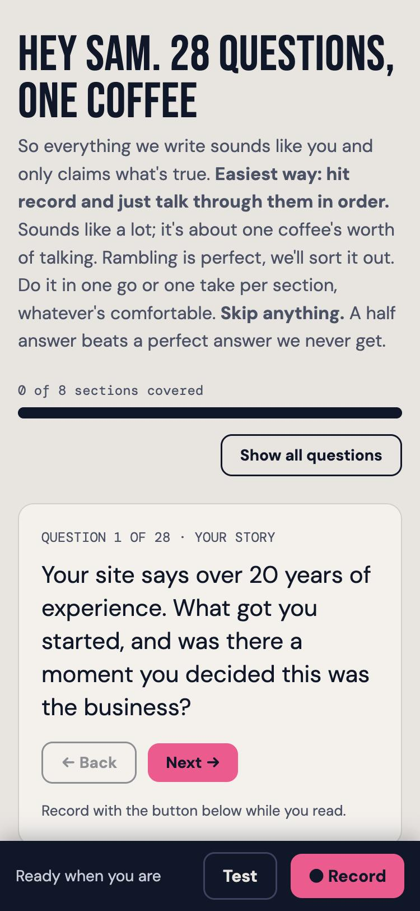
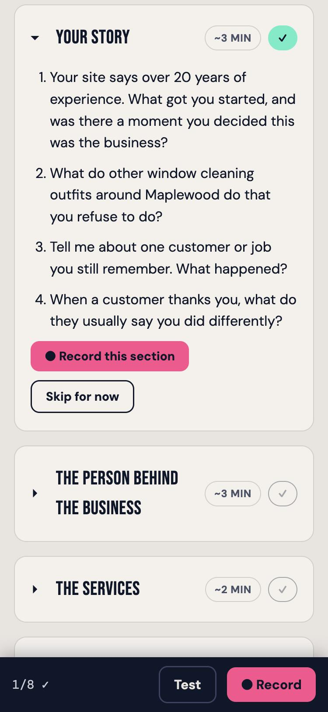
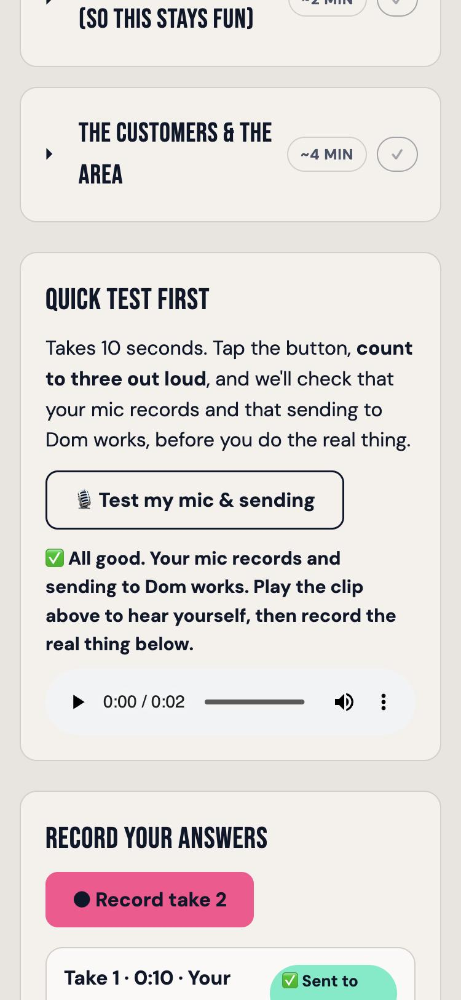
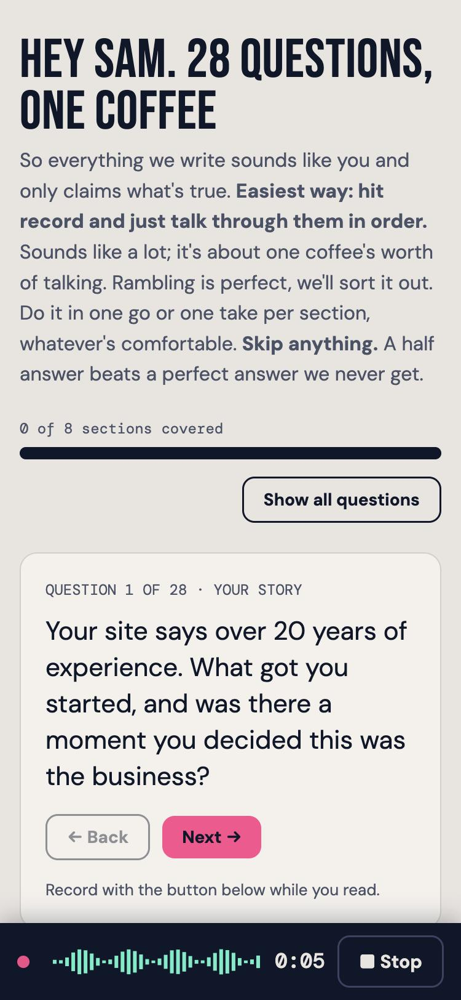
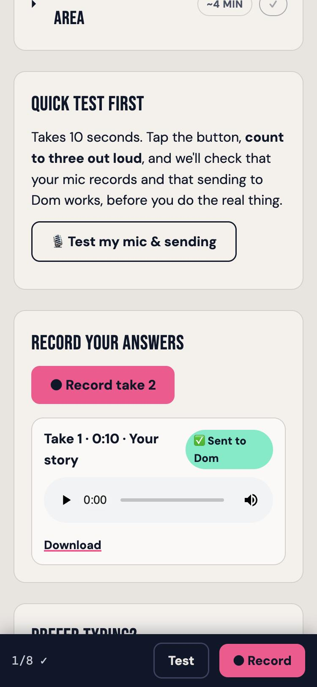
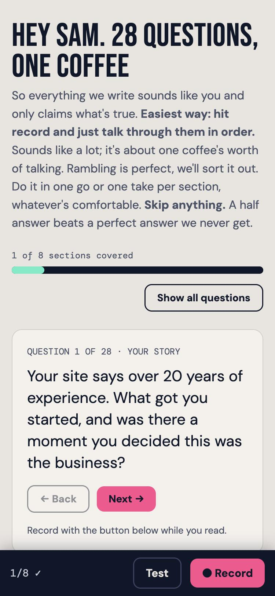

# Easy Client Voice-Note Onboarding

Onboard a new client the human way: **they talk, you listen, Claude runs everything.**

You get a beautiful private interview page for each client. The founder opens it on their
phone, taps record, and talks through 25-30 personalized questions (live waveform,
progress bar, section-by-section, built to be friendly to busy and easily-distracted
people). When they're done, Claude pulls the recordings, transcribes them on your
computer, and writes the four documents every content engagement needs:

1. **Brand brief** — who they are, who buys, how they win
2. **Founder story** — their voice, kept verbatim
3. **Approved claims** — what you may publish, with sources
4. **Prohibited claims** — what you must never say in their name

## All you need

- **[Claude Code](https://claude.com/claude-code)** (the AI does all technical work)
- **A free [Cloudflare](https://cloudflare.com) account** (hosts your interview page and
  stores the recordings, on the free tier)

**That's it.** No GitHub. No servers. No code to understand. You never open a terminal
yourself; Claude does.

## Getting started (three sentences, ever)

Download this repository (green **Code** button → **Download ZIP**), unzip it, open the
folder in Claude Code, and say:

> **"Set up my intake system."**

Claude installs the tools, walks you through the one Cloudflare login, deploys your page,
and tests it (about 30 minutes, once). From then on, per client:

> **"Onboard my client, their website is example-client.com"**

Claude researches their site and reviews, writes their personalized questions, puts them
on your page, and gives you the private link to send. And when your client tells you
they've finished:

> **"The client says he's done."**

Claude fetches the recordings, transcribes them, and writes the four onboarding documents.

## What the founder experiences

A private link. No login, no app, no form. Questions that quote their own website back at
them ("Your site says 20 years, what got you started?"), a big record button with a live
waveform so they can see it's working, one section at a time with skipping officially
allowed, and progress that's still there if they come back tomorrow. It reads like someone
did their homework, because someone did.

## What it looks like

Screenshots of the demo page at phone width, which is how the founder sees it. The client is
fictional ("ClearView Exterior Care"). The page is rendered from `system/worker.js` with the
placeholders filled in.

| Questions, all sections | One question at a time | Record a section | Mic test |
|:--:|:--:|:--:|:--:|
|  |  |  |  |

| Live recording | Take sent | Progress |
|:--:|:--:|:--:|
|  |  |  |

## What's in this repo

| Path | What it is |
|---|---|
| `SKILL.md` | The brain: the full workflow Claude follows |
| `SETUP.md` | The one-time setup, written for Claude to execute |
| `system/` | The interview page (Cloudflare Worker), config, and the transcribe script |
| `question-bank.md` | The master question bank with the reasoning behind every block |
| `templates/` | The four document templates + a static (non-recording) question sheet |
| `example/` | A complete worked example for a fictional window-cleaning company |

## No Cloudflare? There's a lite mode

Everything also works with zero setup: Claude generates the personalized questions as a
document, the founder answers by **WhatsApp voice notes**, and you paste the transcripts
back. Same questions, same four documents, no page. Say *"onboard my client without the
page"* and Claude takes that route (details in `SKILL.md`).

## Privacy

Recordings upload to **your own** Cloudflare account behind an unguessable link, are
write-only from the page, and are transcribed on **your own** computer. Nothing touches
anyone else's servers. Rotating one token kills an old link instantly.

## Provenance

Distilled from the client-onboarding system built and battle-tested at
[JUST DIGITAL](https://justdigital.world) on real local-service engagements. The example
client is fictional. MIT licensed: use it, adapt it, onboard someone.
